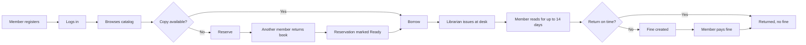
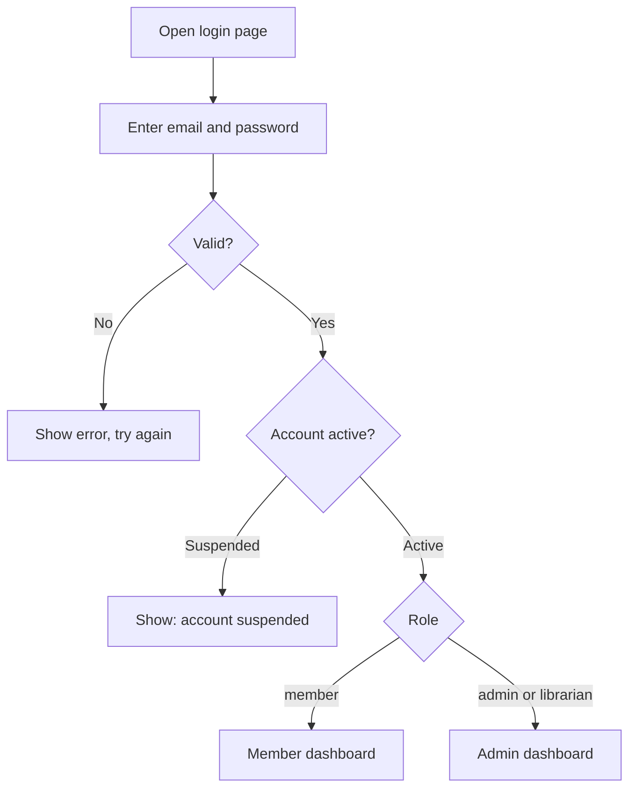
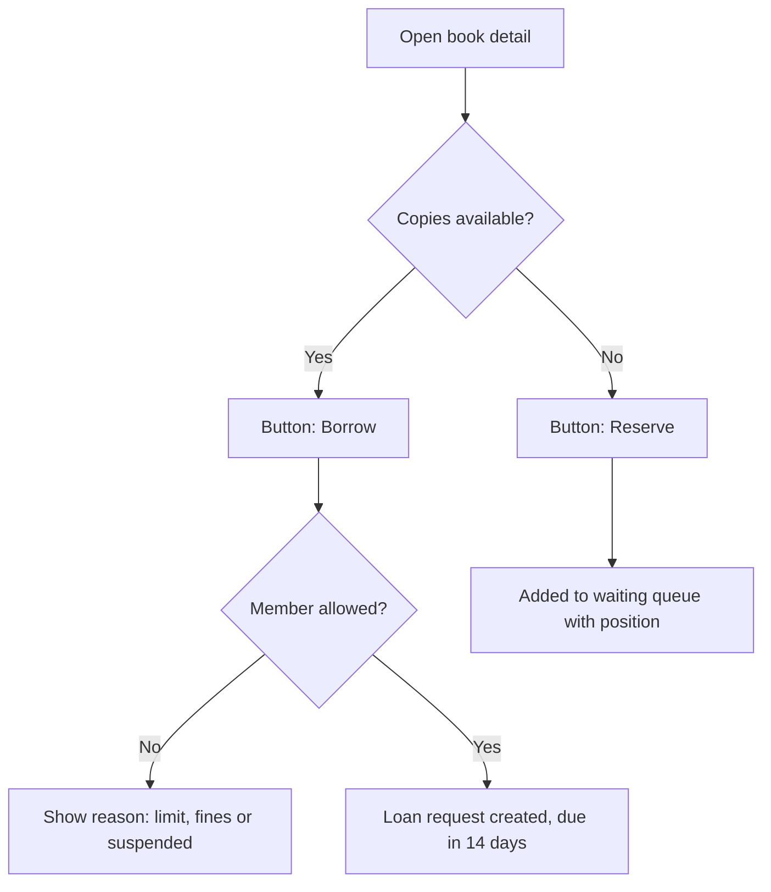
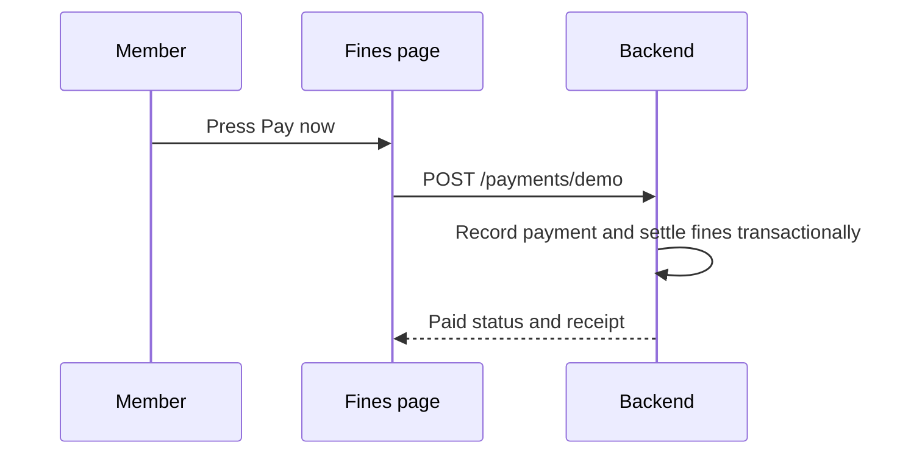
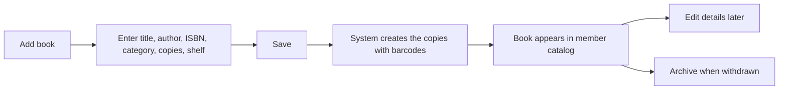
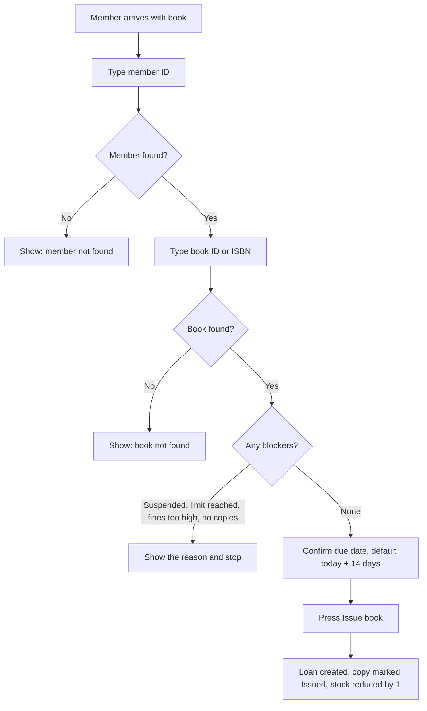
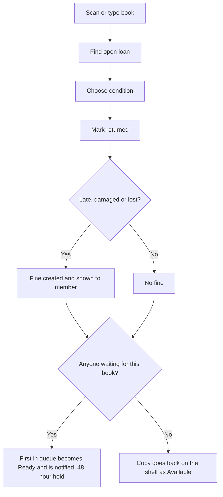
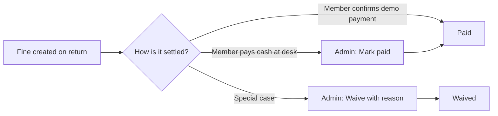

# LibraryHub – User and Admin Workflow

A plain-language guide to how the system works, from first login to the last payment. Use it to understand the screens, the rules behind them, and which API call each step uses.

**Related files:** `01-mongodb-schema.md` (database), `02-api-details.md` (endpoints)

---

## 1. Who uses the system

| Role | Who they are | Where they work |
|---|---|---|
| **Member** | Student, faculty or public reader | Member portal (`/dashboard`, `/catalog`, `/loans`, `/fines`, `/profile`) |
| **Librarian** | Staff at the desk | Admin console (issue, return, reservations, fines) |
| **Admin** | Library manager | Admin console (everything, plus settings, waivers and reports) |

Key rules the whole system follows:

- A book **title** has one or more physical **copies**. Only copies are issued.
- Default loan period is **14 days** (30 for faculty). Up to **2 renewals** of 7 days; admins can change the policy in settings.
- Overdue fine is **₹5 per day**, capped per book.
- A member with a **suspended** account, too many loans, or high unpaid fines cannot borrow.
- Successful administrative write actions are recorded in persistent audit history.

---

## 2. Big picture: life of a book loan

---

# PART A – MEMBER WORKFLOW

## A1. Register a new account

**Page:** `/register`

1. Open the register page and fill in name, phone, email.
2. Pick a membership type: **Student**, **Faculty** or **Public** (this sets the loan period and book limit).
3. Create a password. The strength bar must show at least *Good*.
4. Tick the library rules checkbox and press **Create account**.
5. The system creates the account, signs the member in, and opens the **Dashboard**.

| Step | API |
|---|---|
| Create account | `POST /auth/register` |

**What can go wrong:** email already used, weak password, passwords do not match. The form shows a red message.

---

## A2. Log in

**Page:** `/login`

1. Enter email and password, press **Sign in**.
2. The server checks the credentials and returns an access token.
3. A **member** goes to `/dashboard`. A **librarian or admin** goes to `/admin`.

| Step | API |
|---|---|
| Sign in | `POST /auth/login` |
| Stay signed in | `POST /auth/refresh` (automatic) |
| Log out | `POST /auth/logout` |

After 5 wrong passwords the account is locked for 15 minutes.

---

## A3. Dashboard: see your situation at a glance

**Page:** `/dashboard`

The member sees:
- **Overdue alert** (red box) if any book is late, with a *View loans* button.
- Four counters: books borrowed, due this week, reservations, pending fines.
- A list of **currently borrowed books** with due dates.
- **New arrivals**.

| Step | API |
|---|---|
| Load page | `GET /me/dashboard` |

---

## A4. Browse and search books

**Page:** `/catalog`

1. Type in the search box (title, author or ISBN). The top bar search also lands here.
2. Narrow down with the **category** dropdown or the **Available only** checkbox.
3. The grid shows each book with a green **Available** or red **Borrowed** badge and a rating.
4. Click a book card to open its detail page.

| Step | API |
|---|---|
| List and filter | `GET /books?q=&category=&availability=` |
| Category list | `GET /categories` |

---

## A5. Book detail: borrow, reserve or wishlist

**Page:** `/catalog/:id`

The page shows cover, author, rating, ISBN, pages, shelf and how many copies are free. The main button depends on availability:

- **Borrow** (`POST /books/:id/borrow`): creates the loan. By default the member then collects the book and the librarian confirms at the desk. If *Self checkout* is on in settings, the loan is issued instantly.
- **Reserve** (`POST /books/:id/reserve`): puts the member in the queue (position #1, #2...).
- **Wishlist** (`POST` or `DELETE /books/:id/wishlist`): saves the book for later.

A member cannot borrow the same title twice, or reserve a title already reserved.

Overdue loans and expired ready reservations are processed every minute.
Reservation expiration releases the held copy and promotes the next member in
the queue in the same database transaction.

---

## A6. My loans: renew, return, reservations, history

**Page:** `/loans` (three tabs)

| Tab | What the member does |
|---|---|
| **Active** | Sees issued date, due date, renewals used. Can **Renew** or **Return**. |
| **Reservations** | Sees queue position. Can **Cancel**. |
| **History** | Reads past loans and any fines. |

**Renew rules:** book must not be overdue, fewer than 2 renewals used, and nobody waiting for it. Each renewal adds 7 days.

**Return:** the member presses **Return** to tell the library they are bringing it back. The real return is completed by the librarian at the desk (see B6).

| Step | API |
|---|---|
| Active / history | `GET /me/loans?status=active` / `history` |
| Renew | `POST /loans/:id/renew` |
| Return request | `POST /loans/:id/return-request` |
| Reservations | `GET /me/reservations`, `DELETE /reservations/:id` |

---

## A7. Pay a fine

**Page:** `/fines`

1. A fine appears automatically when a book is returned late (or damaged or lost).
2. The member opens **Fines**. The orange card shows **Total due**.
3. Press **Pay now**.
4. The system immediately marks the selected fines **Paid** and adds a receipt to *Payment history*. No money is charged.

Fine formula: `days late x ₹5`, capped at the per-book maximum. Members whose
unpaid fines pass the limit are blocked from borrowing until the fines are
marked paid. Demo payments only update the displayed system state; they do not
charge money.

---

## A8. Profile and notifications

**Page:** `/profile`

- Update name, email, phone and city (`PATCH /me`).
- Change password (`POST /me/change-password`). New password needs 8+ characters.
- Switch notification toggles: due reminders by email, reservation alerts by SMS, library news.
- The bell in the top bar lists notices such as *Due in 2 days*, *Reservation ready*, *Fine added*.

---

## A9. Member journey summary

| # | Step | Page | Result |
|---|---|---|---|
| 1 | Register | `/register` | Account created |
| 2 | Log in | `/login` | Lands on dashboard |
| 3 | Search | `/catalog` | Finds a book |
| 4 | Borrow or reserve | `/catalog/:id` | Loan or queue spot |
| 5 | Collect book | Library desk | Librarian issues it |
| 6 | Renew if needed | `/loans` | +7 days |
| 7 | Return | Library desk | Loan closed |
| 8 | Pay fine if late | `/fines` | Fine cleared |

---

# PART B – ADMIN / LIBRARIAN WORKFLOW

## B1. Admin login

**Page:** `/admin/login`

1. Enter staff email and password.
2. The system checks the **role**. A normal member is refused with *This account does not have staff access*.
3. On success the staff member lands on the **Admin Dashboard**.

---

## B2. Admin dashboard: start of the day

**Page:** `/admin`

- Counters: total books, members, issued today, overdue.
- **Circulation this week** chart (issued vs returned).
- **Most overdue** list with days late, linking to Fines.
- **Recent activity** feed.
- **Issue book** shortcut button.

| Step | API |
|---|---|
| Load page | `GET /admin/dashboard` |

---

## B3. Manage the book catalog

**Page:** `/admin/books`

| Action | How | API |
|---|---|---|
| Add | **Add book** button, fill the popup | `POST /admin/books` |
| Edit | **Edit** on a row | `PATCH /admin/books/:id` |
| Delete | **Delete** (archives, history kept; blocked if copies are on loan) | `DELETE /admin/books/:id` |
| Search | Search box and category filter | `GET /admin/books` |

---

## B4. Manage members

**Page:** `/admin/members`

- Tabs: **All**, **Active**, **Suspended**. Search by name, email or member ID.
- **Add member** creates the account and emails a temporary password.
- **Suspend** blocks borrowing and login to the member portal. **Activate** restores access.
- Fines and loan counts are shown per member so the librarian can see problems quickly.

| Action | API |
|---|---|
| List | `GET /user` (admin only) |
| Create | `POST /user/create/member` |
| Suspend / activate | `PATCH /user/:id` |

---

## B5. Issue a book (desk)

**Page:** `/admin/issue` – left card

Behind the scenes (one database transaction): copy status becomes *issued*, book available count drops by 1, member's active loans rise by 1, and if the member had a **Ready** reservation it is marked *fulfilled*.

| Step | API |
|---|---|
| Look up member / book | `GET /admin/lookup/member`, `GET /admin/lookup/copy` |
| Issue | `POST /admin/loans/issue` |

---

## B6. Return a book (desk)

**Page:** `/admin/issue` – right card

1. Type the book ID or ISBN. The system finds the open loan and shows who borrowed it and the due date.
2. Choose the **condition**: Good, Damaged (extra ₹100) or Lost (extra ₹500).
3. The page shows the fine preview: *8 days late at ₹5 per day = ₹40*.
4. Press **Mark returned**.

| Step | API |
|---|---|
| Return | `POST /admin/loans/return` |
| Mark lost | `POST /admin/loans/:id/mark-lost` |

---

## B7. Handle reservations

**Page:** `/admin/reservations`

| Status | Meaning | Admin action |
|---|---|---|
| **Waiting** | Member is in the queue, book is out | **Notify** (if a copy just came back) or **Cancel** |
| **Ready** | Copy is held for the member for 48 hours | Wait for collection, then issue it (B5) |
| Expired | Member did not collect in time | System moves to next person automatically |

Cancelling a reservation renumbers the queue (#2 becomes #1).

| Action | API |
|---|---|
| List | `GET /admin/reservations` |
| Notify | `POST /admin/reservations/:id/notify` |
| Cancel | `DELETE /admin/reservations/:id` |

---

## B8. Collect or waive fines

**Page:** `/admin/fines`

- Top cards: **Pending**, **Collected**, **Waived** totals.
- Tabs: Unpaid, Paid, Waived, All.
- **Mark paid**: use when a member pays cash at the desk.
- **Waive**: admin only. A written **reason is required** and stored with the fine. Successful administrator and librarian writes are recorded in persistent audit history.

| Action | API |
|---|---|
| List | `GET /admin/fines` |
| Cash payment | `POST /admin/fines/:id/pay` |
| Waive | `POST /admin/fines/:id/waive` |

---

## B9. Reports

**Page:** `/admin/reports`

- Switch between **This week** and **This month**.
- See books issued vs returned, fines collected, category split and the most borrowed books.
- **Export CSV** downloads the data for spreadsheets.

| Action | API |
|---|---|
| Charts | `GET /admin/reports/circulation`, `/most-borrowed`, `/fines` |
| Export | `GET /admin/reports/export?type=circulation&format=csv` |

---

## B10. Settings (admin only)

**Page:** `/admin/settings`

| Group | What can be changed |
|---|---|
| Loan periods | Days for student, faculty and public; maximum renewals; days per renewal |
| Fines | Fine per day, maximum fine per book |
| Reservations | Hold time (default 48 hours), reminder days before due |
| Automation | Self checkout, due date emails, auto suspend for high fines |

Changes apply to **new** loans and fines. Existing loans keep their original due dates.

| Action | API |
|---|---|
| Read / save | `GET` and `PATCH /admin/settings` |

---

## B11. Admin day-to-day summary

| Time | Task | Page |
|---|---|---|
| Morning | Check overdue list and activity | `/admin` |
| Morning | Handle new member sign-ups, suspensions | `/admin/members` |
| All day | Issue and return books at the desk | `/admin/issue` |
| All day | Notify reservations when copies return | `/admin/reservations` |
| Afternoon | Collect cash fines, waive special cases | `/admin/fines` |
| When stock arrives | Add new titles and copies | `/admin/books` |
| Weekly | Export circulation report | `/admin/reports` |
| Rarely | Change policy | `/admin/settings` |

---

# PART C – HOW MEMBER AND ADMIN ACTIONS CONNECT

| Member does | Admin sees / does | System does automatically |
|---|---|---|
| Registers | New active member account | Signs in immediately; no email verification |
| Borrows a book | Issues it at the desk | Creates loan, reduces stock |
| Reserves a full book | Sees it in Reservations | Adds queue position |
| Reaches due date | Sees it in Most overdue | Scheduled job marks loan *overdue* |
| Returns book late | Presses Mark returned | Creates fine, notifies member |
| Pays fine in demo mode | Fine shows **Paid** | Records a demo payment and updates the balance; no money is charged |
| Pays fine in cash | Presses Mark paid | Updates member's fine total |
| Asks for a waiver | Waives with reason | Stores waiver reason with the fine |

## Status reference

| Object | Statuses |
|---|---|
| Loan | `issued` → `returned` (or `overdue` → `returned`, or `lost`) |
| Reservation | `waiting` → `ready` → `fulfilled` (or `cancelled`, `expired`) |
| Fine | `unpaid` → `paid` (or `waived`) |
| Member | `active`, `suspended`, `expired`, `pending` |
| Book copy | `available`, `issued`, `reserved`, `damaged`, `lost`, `withdrawn` |

## Automatic background jobs

| Job | When | Effect |
|---|---|---|
| Mark overdue | Daily, just after midnight | Late loans become *overdue*, fines start counting |
| Due reminders | Daily, 8 AM | Notifies members whose books are due soon |
| Expire reservations | Hourly | Releases uncollected holds to the next person |
| Expire memberships | Daily | Sets lapsed members to *expired* |